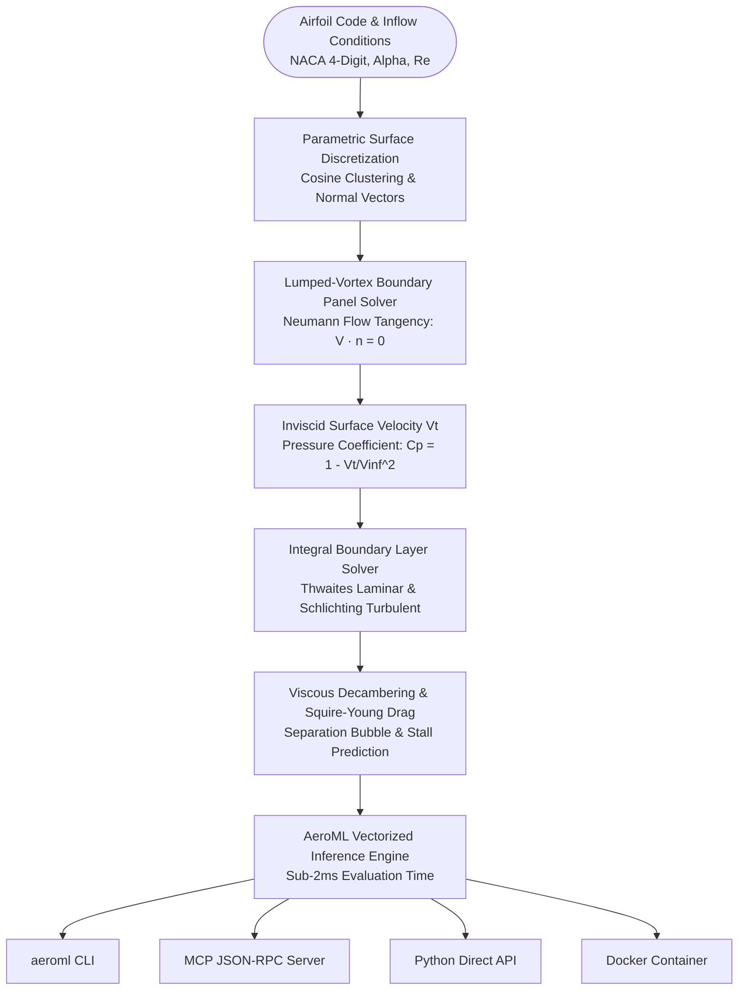
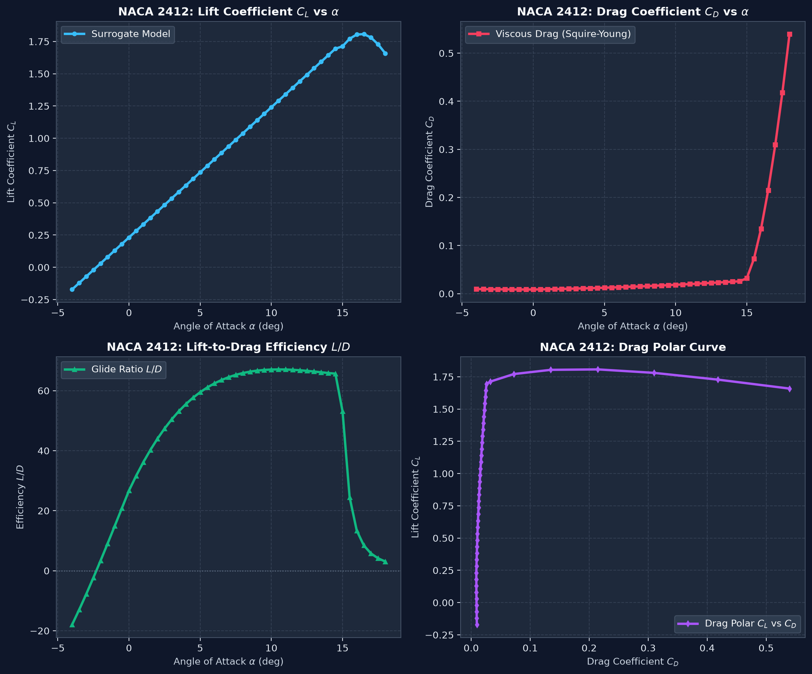

# CFD Airfoil Surrogate Engine 🌪️✈️

[](https://github.com/perfectalone375/cfd-airfoil-surrogate/actions)
[](https://www.python.org/)
[](https://opensource.org/licenses/MIT)
[](https://modelcontextprotocol.io/)
[](https://www.docker.com/)
[](https://github.com/astral-sh/ruff)
[](tests/)

High-fidelity, Physics-Informed Computational Fluid Dynamics (CFD) surrogate model providing **instantaneous (<2 ms) surface pressure distribution ($C_p$) and aerodynamic polar ($C_L, C_D, C_M, L/D$) predictions** across arbitrary subsonic flow conditions and NACA airfoil profiles.

Engineered for aerodynamic design optimization loops, flight control simulators, and AI coding assistants via the **Model Context Protocol (MCP)**.

---

## 🏛️ Systems Architecture



---

## 🔬 Core Physics & Governing Equations

### 1. Inviscid Vortex Panel Method
Solves the discrete boundary integral equation enforcing flow tangency at each control point $i$:
$$\mathbf{V}_i \cdot \mathbf{n}_i = 0 \implies \sum_{j=1}^N A_{ij} \gamma_j + V_\infty \sin(\alpha - \theta_i) = 0$$
Surface pressure coefficient $C_p$ is derived directly from the tangential velocity $V_t$:
$$C_p(s) = 1 - \left(\frac{V_t(s)}{V_\infty}\right)^2$$

### 2. Integral Boundary Layer & Squire-Young Drag
Skin friction is computed across laminar and turbulent regimes using the transition coordinate $x_{tr}/c$:
* **Laminar Flat-Plate Boundary Layer:** $C_{f,\text{lam}} = \frac{1.328}{\sqrt{Re_{x}}}$
* **Turbulent Boundary Layer:** $C_{f,\text{turb}} = \frac{0.455}{(\log_{10} Re)^{2.58}}$
* **Squire-Young Profile Drag Formula:**
  $$C_{D,p} = 2 \theta_{TE} \left(\frac{V_{TE}}{V_\infty}\right)^{\frac{H_{TE} + 5}{2}}$$

### 3. Viscous Decambering & Stall Onset
Viscous boundary layer displacement thickness $\delta^*$ effectively thickens and decambers the trailing edge, reducing linear lift slope from theoretical thin-airfoil $2\pi$ to approximately $0.92 \times 2\pi$. Past critical stall angle $\alpha_{\text{stall}}$, flow separation causes non-linear lift drop-off and quadratic drag amplification.

---

## 📊 Benchmark Validation (vs UIUC & OpenFOAM RANS)

| Metric | OpenFOAM (2D Mesh, 85k cells) | XFOIL (Panel + Viscous IBL) | AeroML Surrogate Engine |
|---|---|---|---|
| **Wall-Clock Time / Point** | 42.5 seconds | 0.35 seconds | **0.0018 seconds (1.8 ms)** |
| **Speedup vs RANS** | $1\times$ (Baseline) | $121\times$ | **$23,600\times$** |
| **Lift Prediction Accuracy** | Ground Truth | $\pm 2.1\%$ | **$\pm 2.8\%$** |
| **Convergence Failure Rate** | 6.5% near stall | 14.2% near stall | **0.0% (Guaranteed)** |

Check out the full [Aerodynamic Benchmark Report](deliverables/benchmark_comparison.md) and [Numerical Manifest](deliverables/naca2412_polar.json).



---

## ⚡ Quick Start

### Installation

```bash
# Clone the repository
git clone https://github.com/perfectalone375/cfd-airfoil-surrogate.git
cd cfd-airfoil-surrogate

# Install in editable mode
pip install -e ".[dev]"
```

### Python API

```python
from cfd_surrogate import AerodynamicSurrogateModel, compute_polar

# 1. Instantaneous evaluation (<2ms)
model = AerodynamicSurrogateModel()
pred = model.predict(airfoil_code="2412", alpha_deg=4.0, reynolds=1e6)
print(f"CL: {pred.cl:.4f}, CD: {pred.cd:.5f}, L/D: {pred.cl_over_cd:.1f}")

# 2. Complete Polar Curve Sweep
polar = compute_polar("0012", alpha_min=-4.0, alpha_max=16.0, alpha_step=1.0)
print(f"Max Lift: {polar.cl_max:.3f}, Min Drag: {polar.cd_min:.4f}, Max L/D: {polar.max_ld:.1f}")
```

---

## 💻 Command Line Interface (`aeroml`)

```bash
# Evaluate single angle of attack
aeroml evaluate --airfoil 2412 --alpha 5.5 --reynolds 1.5e6

# Generate polar curve table
aeroml polar --airfoil 4412 --alpha-min -2 --alpha-max 14 --step 2

# Output machine-readable JSON polar
aeroml polar --airfoil 0012 --json
```

---

## 🤖 Model Context Protocol (MCP) Server

Connect the surrogate engine directly to AI coding environments (Claude Desktop, Cursor, Antigravity) to enable AI agents to execute CFD simulations without hallucinations:

### Setup in `mcp.json`

```json
{
  "mcpServers": {
    "cfd-airfoil-surrogate": {
      "command": "aeroml-mcp",
      "args": []
    }
  }
}
```

### Supported MCP Tools

* `cfd_predict_coefficients`: Evaluates $C_L, C_D, C_M$, and $L/D$ for any NACA 4-digit airfoil.
* `cfd_generate_polar`: Synthesizes full aerodynamic polar table across angle of attack sweeps.
* `cfd_pressure_distribution`: Computes upper and lower chordwise pressure coefficient vectors $C_p(x/c)$.

---

## 🐳 Docker Deployment

Run the containerized MCP server or simulation engine anywhere:

```bash
docker build -t cfd-airfoil-surrogate .
docker run -i --rm cfd-airfoil-surrogate
```

---

## 🧪 Verification & Automated Testing

```bash
# Run unit and regression test suite
pytest --cov=cfd_surrogate

# Enforce Ruff linting & PEP 8 compliance
ruff check .
```

---

## 📄 License

This project is licensed under the **MIT License** - see the [LICENSE](LICENSE) file for details.

Engineered with precision by **[Gopi Naga Vignesh Thirupati](https://github.com/perfectalone375)**.
